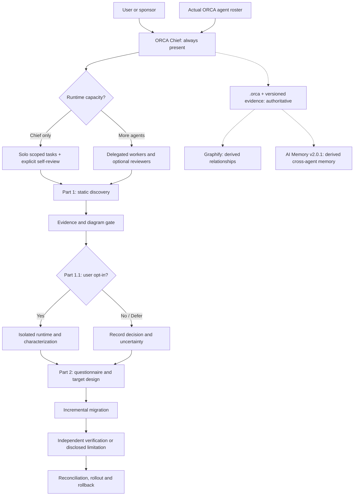

# Migration Architecture

The **generic ORCA layer** owns agent session discovery, contract/role authority, worktree ownership, diaries, task state and review gates. The **migration layer** owns static inspection, selected documentation, optional isolated runtime, user questionnaire, target design, incremental implementation and acceptance verification.

Mermaid is explanatory. No external service is implied to be connected. Companion modules must accept absence of Graphify, workers, and AI Memory without fabricating results. See `docs/architecture/ORCA-OPERATING-MODEL.md`.
