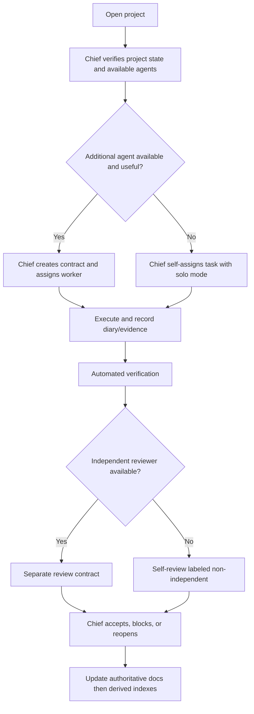

# ORCA Operating Model — Agent-Count Independent

## Discovery at every session

The Chief inspects available agents and capabilities from the **actual installed ORCA runtime**. The agent roster is not hardcoded, and agent names are not inferred from available skill files. Only load the runtime's version-matched orchestration skill and inspect supported commands before delegation.

| Runtime condition | Execution | Acceptance |
| --- | --- | --- |
| Chief only | Chief performs discovery, documentation, coding and verification in bounded sequential tasks | self-review flagged; human approval for high-risk changes |
| Chief + worker(s) | Chief assigns scoped tasks with explicit skills, paths and dependencies | Chief accepts tested deliverables |
| Reviewer available | Independent role reviews artifacts without editing them | independent review recorded |
| Reviewer unavailable | Chief runs deterministic verification and records limitations | never claim independence |
| Memory/Graphify unavailable | Direct repository and contract inspection | record degraded context; do not hallucinate tool output |

The Chief can re-evaluate the roster after any session change. Phase descriptions and document locations remain invariant across modes.

## Shared protocol

Protocol events include PROPOSE, ASSIGN, ACCEPT, STATUS, QUESTION, BLOCKED, ESCALATE, DELEGATE, REVIEW_REQUEST, REVIEW_RESULT, HANDOFF, DONE, CANCEL. Individual contracts have a single primary task owner; active workers do not overwrite other worktrees. A contract grants task permission, never additional GitHub or system rights.

For the full message envelope, contract lifecycle and diary records, see [ORCA Protocol Reference](ORCA-PROTOCOL.md).

## Files and authority

- `.orca/PROJECT.md`: durable goal, scope and project rules.
- `.orca/EXEC.md`: current runtime tasks and agent worktree ownership.
- `.orca/roles/`: permitted and optional responsibilities.
- `.orca/phases/<phase>/PHASE.md`: entry/exit criteria and gate requirements.
- `.orca/phases/<phase>/tasks/`: concrete actionable work, no fake historical tasks.
- `.orca/phases/<phase>/diaries/`: per-agent execution records.
- `.orca/contracts/active|completed/`: explicit grants and acceptance trail.
- `.orca/SUMMARY.md`, `.orca/LESSONS_LEARNED.md`: summarized project knowledge.
- `GRAPHIFY.md` and `graphify-out/`: optional derived relationship index.
- AI Memory MCP: optional per-project memory and cross-client handoff, not authoritative project state.

Keep state changes in authoritative files before updating Graphify or AI Memory. Never treat retrieval scores as proof. Do not publish repository data to external model providers without authorization.

## Setup-first contract establishment

Starting the existing `superpower-orca` must load `orca-setup` after `orca-project-entry`. The Chief proposes a real staffing/permission matrix before starting implementation: verified agent ID, role, allowed files, task ID, required skills, review independence and contract acceptance state. The user decides whether additional agents are used. There are five Superpowers, including Part 3 operational assurance; `setup-orca` remains an activation alias of `superpower-orca`.

On user-approved delegation the Chief issues work contracts with the documented ORCA/ASSIGN and requires actual ORCA/ACCEPT. When only a Chief is available, tasks are self-owned and sequential; an external acceptance or independent reviewer must not be invented. Project memory setup is offered during this process but remains opt-in and requires live MCP/hook checks in each runtime client.

